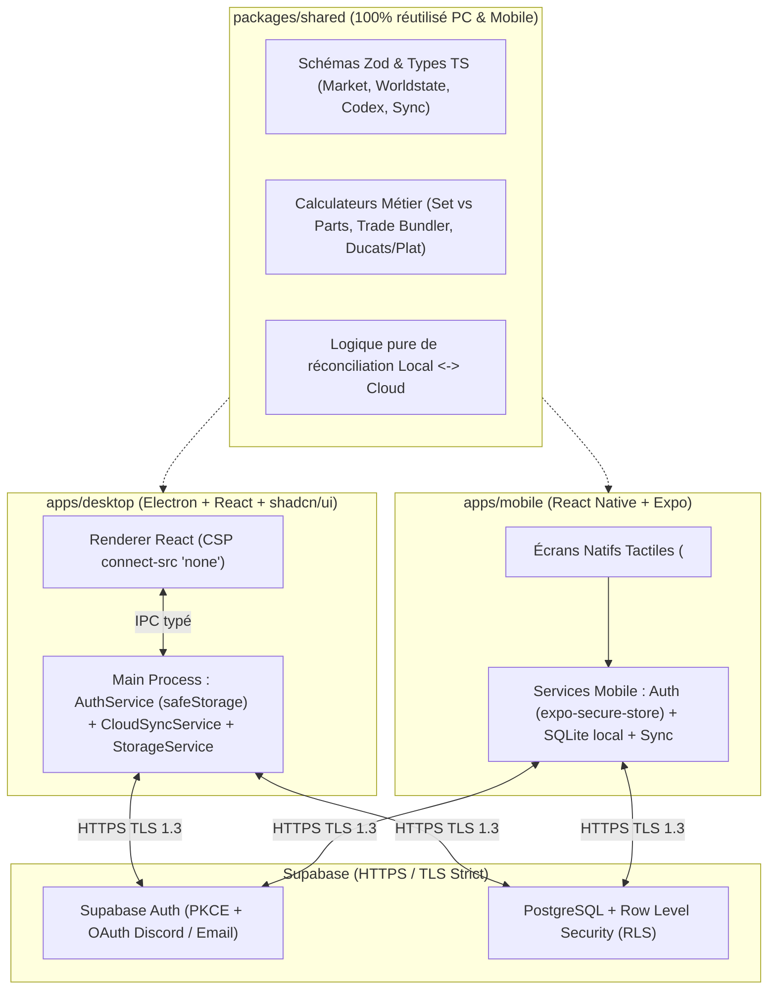

# Note de Cadrage Future — Synchronisation Cloud (Supabase) & Application Mobile (React Native)

- **Projet** : WireFrame — Évolution Multi-Plateforme (Desktop Electron $\leftrightarrow$ Mobile iOS/Android)
- **Auteur** : Maxime (`Nyxo_17`)
- **Statut** : `EN RÉSERVE / BACKLOG ARCHITECTURE` *(À spécifier dans le CDC et maquetter sur Excalidraw avant toute ligne de code)*

---

## 1. Objectif Métier

Permettre à un joueur utilisant **WireFrame** sur son **PC (Electron)** et sur son **téléphone iOS / Android (React Native / Expo)** de **s'authentifier avec un compte unique** afin de retrouver automatiquement l'état complet de son application d'un appareil à l'autre :
- Préparer son panier d'achats, ses favoris ou ses alertes *Price Sniper* dans le bus ou le canapé sur son téléphone ;
- Allumer son PC le soir et retrouver instantanément son panier, ses favoris, ses thèmes et ses alertes prêts en jeu dans l'Overlay WireFrame.

> **Principe UX fondamental (« Local-First & Compte Optionnel »)** :
> WireFrame doit toujours fonctionner **sans compte obligatoire** en stockage local hors-ligne. La connexion au compte vient **sauvegarder et synchroniser** l'état local vers le cloud sans jamais bloquer un joueur qui préfère rester 100 % local.

---

## 2. Pourquoi Supabase est le bon choix technique

**Supabase** est une plateforme Backend-as-a-Service Open Source construite autour d'une vraie base de données **PostgreSQL** :

1. **Authentification clé en main (`Supabase Auth`)** :
   - Connexion par **OAuth Discord** (idéal pour la communauté Warframe), Google, Apple (requis sur iOS si d'autres logins sociaux sont proposés) ou Email / *Magic Link*.
   - Gestion standardisée des jetons JWT (`access_token` court + `refresh_token`) avec flux **PKCE** sécurisé pour applications natives Desktop et Mobile.
2. **Sécurité native au niveau des lignes (`Row Level Security` — RLS)** :
   - PostgreSQL vérifie directement dans la base de données que `auth.uid() = user_id`. Même avec la clé publique de l'application, un utilisateur ne peut **jamais** lire ni modifier les données d'un autre joueur.
3. **Synchronisation légère & Temps Réel (`Supabase Realtime` / REST)** :
   - Synchronisation à l'ouverture de l'application, à chaque modification (avec *debounce*), et optionnellement en temps réel via WebSocket sécurisé si le PC et le téléphone sont ouverts en même temps.
4. **Compatibilité 100 % TypeScript (`@supabase/supabase-js`)** :
   - Un seul SDK officiel et typé utilisable côté **Electron Main Process** (Node.js) comme côté **React Native / Expo**, avec génération automatique des types TypeScript depuis le schéma PostgreSQL.
5. **Coût maîtrisé** :
   - En ne stockant que l'état personnel léger des joueurs (quelques kilo-octets par utilisateur), l'offre gratuite (*Free Tier*) couvre largement le développement et des milliers d'utilisateurs actifs.

---

## 3. Périmètre des Données : Quoi Synchroniser (et Quoi Garder Local)

### 3.1. Données synchronisées dans Supabase (liées à `user_id`)

| Table / Domaine | Contenu synchronisé PC $\leftrightarrow$ Mobile | Stratégie de conflit |
| :--- | :--- | :--- |
| **`user_preferences`** | Plateforme (`pc`, `ps4`, `xbox`, `switch`), Crossplay, Langue (`fr`/`en`), Thème bicolore, Dégradé de fond, Niveau d'animations | *Last-Write-Wins* basé sur `updated_at` |
| **`user_favorites`** | Slugs des items Warframe Market & entrées Codex mises en favoris (`created_at`) | Union / suppression horodatée par élément |
| **`user_cart_items`** | Articles du Panier Multi-Achats (*Trade Bundler*) : `item_slug`, rang désiré, quantité | Fusion par `(user_id, item_slug, rank)` + `updated_at` |
| **`user_price_alerts`** | Règles *Price Sniper* : item, type d'ordre, rang, seuil max en Platinum, état actif/inactif | Fusion par identifiant UUID de règle (`updated_at`) |
| **`user_world_alerts`** | Règles d'alertes Worldstate (cycles Cetus/Vallis/Cambion, fissures, invasions, Baro) | Fusion par identifiant UUID de règle (`updated_at`) |
| **`user_pinned_tabs`** *(optionnel)* | Onglets épinglés par le joueur pour les retrouver en accès rapide sur mobile | Liste ordonnée horodatée |

### 3.2. Données qui restent STRICTEMENT locales à chaque appareil

- **Réglages matériels / OS propres au PC** : coordonnées `(x, y, width, height)` des fenêtres Desktop et Compact Overlay, raccourcis clavier globaux Windows (`Alt+Shift+W`, etc.), comportement de fermeture dans le *System Tray*.
- **Données publiques volumineuses & Caches API** : catalogue des ~3 900 items Warframe Market, base Codex/Helminth (~5 Mo), icônes en cache disque et ordres en direct (ces données viennent directement des APIs publiques et ne doivent pas polluer Supabase).

---

## 4. Architecture Cible Multi-Plateforme (Monorepo + Clean Architecture)

Lorsque le chantier Mobile + Cloud démarrera, le dépôt pourra évoluer proprement vers un **Monorepo TypeScript** sans réécrire la logique métier :

---

## 5. Exigences de Sécurité Intransigeantes (« Security by Design »)

1. **Zéro secret serveur dans les applications clientes** :
   - Seule la clé publique Supabase (`anon` / `publishable key`) est utilisée dans Desktop et Mobile.
   - **Interdiction absolue** d'embarquer la clé `service_role` dans le code ou les variables d'environnement du build client.
2. **Row Level Security (RLS) obligatoire sur 100 % des tables** :
   - Aucune table du schéma `public` ne doit exister sans `ENABLE ROW LEVEL SECURITY` et ses politiques `SELECT / INSERT / UPDATE / DELETE` vérifiant `(select auth.uid()) = user_id`.
3. **Stockage chiffré des jetons de session (`refresh_token`)** :
   - **Jamais de jeton d'authentification en clair dans `localStorage` ou dans `config.json`**.
   - **Sur Electron (PC)** : chiffrement via l'API native **`safeStorage`** d'Electron (adossée à Windows DPAPI / macOS Keychain / libsecret), gérée exclusivement dans le **Main Process** (gardant la CSP `connect-src 'none'` intacte côté Renderer).
   - **Sur React Native (Mobile)** : chiffrement matériel via **`expo-secure-store`** (Keychain iOS / Keystore Android).
4. **Flux OAuth externe avec PKCE (Zéro WebView embarquée)** :
   - La connexion OAuth (ex. Discord) s'ouvre dans le navigateur système de confiance (`shell.openExternal` sur PC / `expo-web-browser` sur Mobile) avec échange **PKCE** et retour sur un protocole dédié (`wireframe://auth/callback`), protégeant les identifiants du joueur.
5. **Validation `zod` systématique** :
   - Toutes les lignes lues depuis Supabase sont revalidées par des schémas `zod` versionnés avant d'écraser le stockage local (protection contre les corruptions ou écarts de versions entre Desktop et Mobile).

---

## 6. Jalon Bloquant avant Lancement de cette Phase

Conformément à la charte d'ingénierie WireFrame, **aucune dépendance `@supabase/supabase-js` ni aucun code mobile ne sera installé** tant que :
1. La **v2.0 Desktop** n'est pas finalisée et stabilisée.
2. Le **schéma SQL + politiques RLS + règles de fusion premier login** (ex. *« Vous avez déjà 12 favoris en local sur ce PC, voulez-vous les fusionner avec votre compte Cloud ? »*) ne sont pas rédigés et validés dans le CDC.
3. Les **Wireframes Excalidraw** de l'espace Compte / Synchronisation (Desktop `1440×900`, Compact `460×660`, et Mobile `390×844` avec leurs 4 états UI) ne sont pas validés.
